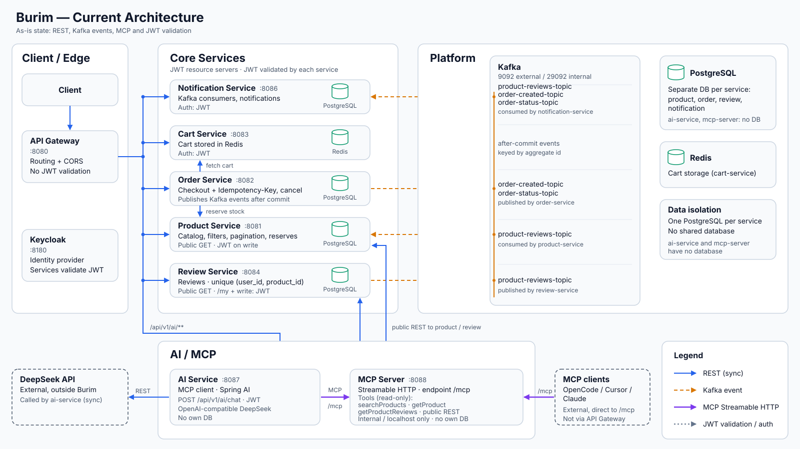
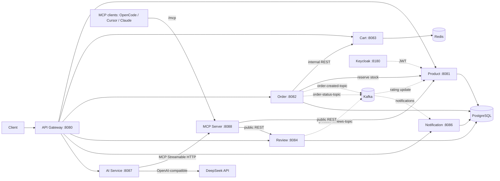
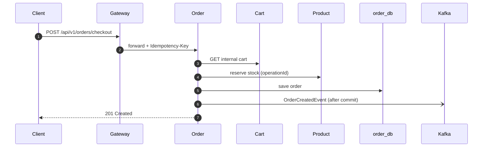
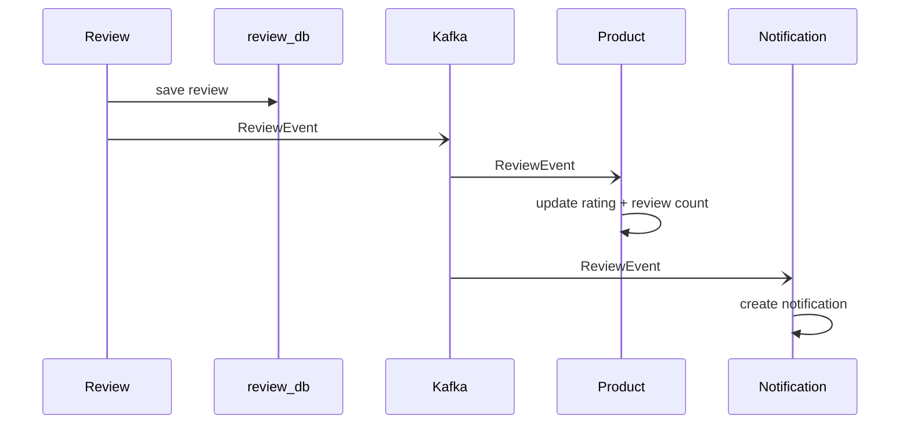
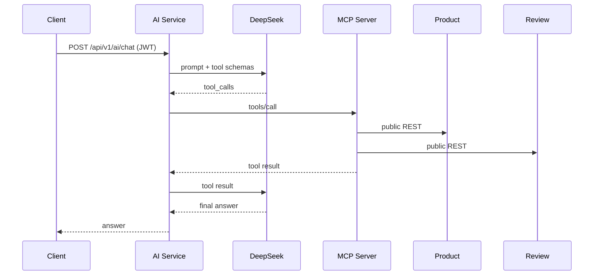

# Burim

[](https://github.com/godsGived/burim/actions/workflows/ci.yml)


Burim is a microservice marketplace built to practice distributed backend patterns: REST, Kafka events, Redis, PostgreSQL, Keycloak, Testcontainers, MCP and tool calling.

> Current status: backend v1.0 and AI chat/MCP are implemented.

## Architecture

<p align="center">
  <picture>
    <source media="(prefers-color-scheme: dark)" srcset="docs/architecture/architecture-dark.svg">
    
  </picture>
</p>

<sub>Full-size: [light SVG](docs/architecture/architecture-light.svg) · [dark SVG](docs/architecture/architecture-dark.svg)</sub>



JWT is validated by each service, not by the gateway. Public reads are available for products, product reviews and single reviews.

## Services

| Service | Port | Responsibility | Storage |
|---|---:|---|---|
| api-gateway | 8080 | Routing, CORS, Springdoc aggregation | — |
| product-service | 8081 | Catalog, filters, pagination, stock reservations | PostgreSQL |
| cart-service | 8083 | Cart | Redis |
| order-service | 8082 | Checkout, idempotency, cancellation | PostgreSQL |
| review-service | 8084 | Reviews and review events | PostgreSQL |
| notification-service | 8086 | Kafka consumers and notifications | PostgreSQL |
| ai-service | 8087 | Chat API, Spring AI, MCP client | — |
| mcp-server | 8088 | Read-only MCP tools over Streamable HTTP | — |

## Core flows

### Checkout



### Review → rating



### AI chat → MCP



## AI & MCP

- `ai-service` uses Spring AI 2.0.2 with an OpenAI-compatible DeepSeek model.
- `POST /api/v1/ai/chat` is stateless and requires JWT.
- `ai-service` is an MCP client; `mcp-server` is a separate MCP server.
- MCP transport: Streamable HTTP, endpoint `/mcp`.
- Read-only tools: `searchProducts`, `getProduct`, `getProductReviews`.
- `mcp-server` is internal/localhost-only and is not routed through the gateway.
- It can be attached to OpenCode, Cursor or Claude as an external MCP client.

## Quick start

```bash
export SPRING_AI_OPENAI_API_KEY=your_deepseek_key
docker compose up -d --build
```

```bash
curl http://localhost:8080/api/v1/products
```

Get a local Keycloak token:

```bash
TOKEN=$(curl -s -X POST http://localhost:8180/realms/burim/protocol/openid-connect/token \
  -d client_id=burim-client \
  -d grant_type=password \
  -d username=testuser \
  -d password=password | jq -r .access_token)
```

```bash
curl -s http://localhost:8080/api/v1/ai/chat \
  -H "Authorization: Bearer $TOKEN" \
  -H "Content-Type: application/json" \
  -d '{"message":"Find a mechanical keyboard under 150 USD"}'
```

MCP check:

```bash
opencode mcp list
```

## API overview

| Endpoint | Auth | Notes |
|---|---|---|
| `GET /api/v1/products/**` | public | Catalog |
| `POST/PUT/DELETE /api/v1/products/**` | JWT | Product writes |
| `/api/v1/cart/**` | JWT | Cart |
| `/api/v1/orders/**` | JWT | Checkout requires `Idempotency-Key` |
| `GET /api/v1/reviews/products/{id}` | public | No `userId` in public DTO |
| `GET /api/v1/reviews/{id}` | public | No `userId` in public DTO |
| `GET /api/v1/reviews/my` | JWT | Current user's reviews |
| `POST/PUT/DELETE /api/v1/reviews/**` | JWT | Writes and ownership checks |
| `/api/v1/notifications/**` | JWT | Current user's notifications |
| `POST /api/v1/ai/chat` | JWT | AI chat + MCP tool calling |
| `POST /mcp` | internal | MCP Streamable HTTP, not via gateway |

## Testing & CI

- JUnit 5, MockMvc, WireMock.
- Testcontainers for PostgreSQL, Kafka and Redis.
- GitHub Actions matrix per service: `mvn -B clean verify`.

## Known limitations

- Kafka events are published after commit; if Kafka is unavailable, an event can be lost. A transactional outbox is not implemented.
- No TTL or reconciliation for stock reservations.
- No notification deduplication.
- No seller/buyer roles or ownership checks for product writes.
- Cart clear is best-effort; a repeated checkout with the same `Idempotency-Key` still returns `201`.
- Product deletion is hard delete; reviews are not checked against purchases.
- No observability stack or load tests.
- MCP server is unauthenticated and must stay internal/localhost-only.
- AI chat is stateless: no server-side chat history.

## License

No license is declared for this learning project.
